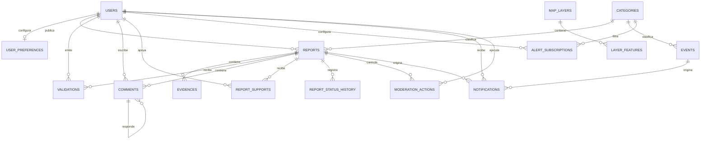

# Modelo entidad–relación de CIVITA

Este modelo corresponde al MVP móvil de Popayán. La fuente editable principal
es `CIVITA_ER.drawio`; este archivo conserva una representación Mermaid útil en
GitHub, GitLab, IntelliJ y Mermaid Live.

## Decisiones clave

- `VALIDATIONS` impone una validación por usuario y reporte.
- `REPORT_SUPPORTS` representa el apoyo comunitario sin duplicados.
- `REPORT_STATUS_HISTORY` no se actualiza: cada transición crea una fila.
- `MODERATION_ACTIONS` registra quién tomó la decisión y por qué.
- `geometry` usa PostGIS para reportes, eventos y elementos de capas.
- El puntaje de confianza se guarda como valor calculado y auditable.
